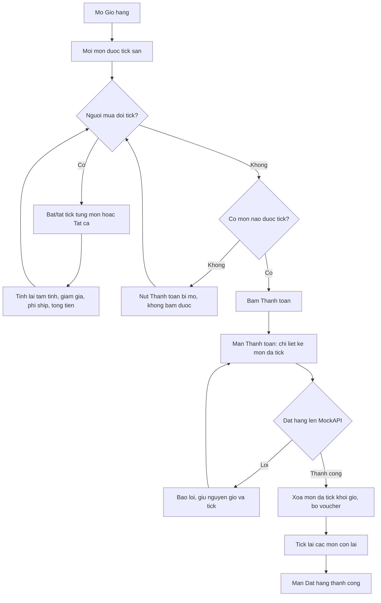
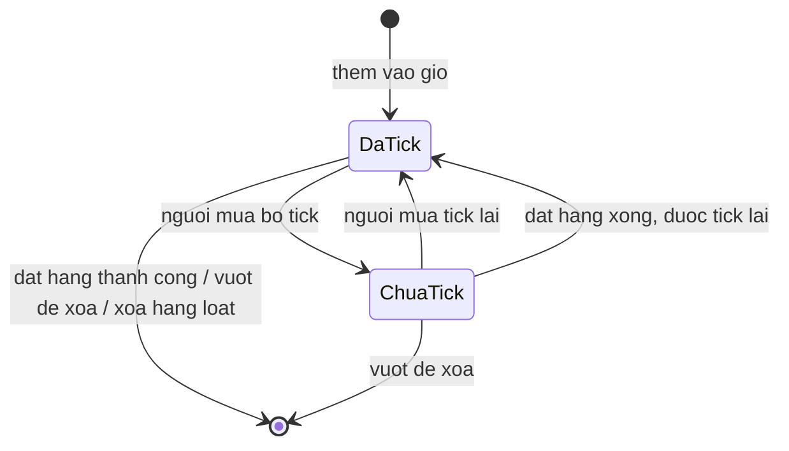

# [QT-01] Chọn sản phẩm cần thanh toán trong giỏ hàng

| Mục | Giá trị |
|-----|---------|
| Dự án | Lumé (`lume_app`) |
| Phiên bản | 1.0 · 2026-11-04 |
| Người yêu cầu | Hạo |
| Ưu tiên | Bình thường |
| Loại | Sửa tính năng có sẵn (MH-15, MH-16, HT-01) |

## 1. Tóm tắt

Người mua mở Giỏ hàng, tick chọn những đôi giày muốn mua trong số đã thêm, xem ngay tổng tiền của
riêng các món đã chọn, rồi bấm Thanh toán. Chỉ các món đã tick được gửi thành đơn hàng và bị trừ
khỏi giỏ; các món chưa tick vẫn nằm trong giỏ cho lần mua sau.

Trước đây màn Giỏ hàng chỉ có một nút `Thanh toán · <tổng cả giỏ>`, nên muốn mua một phần giỏ thì
phải xóa bớt các món chưa cần rồi thêm lại sau.

## 2. Tác nhân và quyền

App chỉ có một loại người dùng, không phân vai trò. Mọi thao tác dưới đây đều là của chính chủ
giỏ hàng, trên máy của họ.

| Tác nhân | Vai trò hệ thống | Được làm gì trong quy trình |
|----------|-----------------|-----------------------------|
| Người mua | người dùng đã đăng nhập (`AuthProvider`) | tick/bỏ tick từng món, tick tất cả, xóa các món đã tick, nhập voucher, bấm Thanh toán |
| App | `CartProvider` (bộ nhớ máy) | giữ trạng thái tick, tính tạm tính / giảm giá / phí ship / tổng tiền theo các món đã tick |
| MockAPI `/orders` | dịch vụ ngoài | nhận đơn chỉ gồm các món đã tick |

## 3. Điều kiện trước

- Giỏ hàng có ít nhất một sản phẩm.
- Mọi dòng trong giỏ đều đang ở trạng thái **đã tick** (xem BR-01).
- Giỏ hàng chỉ nằm trong bộ nhớ, tắt app là mất — đây là hiện trạng, quy trình này không đổi.

## 4. Luồng chính

| Bước | Ai | Hành động | Hệ thống xử lý | Kết quả người dùng thấy | Đã có / Mới |
|------|----|-----------|----------------|--------------------------|-------------|
| 1 | Người mua | Mở tab Giỏ hàng | Dựng danh sách từ `CartProvider.items` | Mỗi dòng có ô tick bên trái, **tick sẵn hết**; thanh dưới hiện tổng tiền và nút `Thanh toán (N)` | Mới |
| 2 | Người mua | Bỏ tick một món | Đổi `selected` của dòng đó, báo cho màn vẽ lại | Ô tick rỗng; tạm tính, giảm giá, phí ship, tổng tiền giảm theo; số N trên nút giảm | Mới |
| 3 | Người mua | Tick lại hoặc tick ô **Tất cả** | Bật/tắt `selected` cho toàn bộ dòng | Mọi ô tick đổi cùng lúc; tiền tính lại | Mới |
| 4 | Người mua | Nhập mã voucher, bấm Áp dụng | Kiểm tra mã; giảm giá tính trên tạm tính của **các món đã tick** | Khung mã hiện "Đã áp dụng ✓"; dòng Giảm giá xuất hiện | Sửa |
| 5 | Người mua | Bấm `Thanh toán (N)` | Mở màn Thanh toán | Màn Thanh toán 3 bước, chỉ liệt kê các món đã tick | Sửa |
| 6 | Người mua | Điền địa chỉ, chọn cách trả, bấm Đặt hàng | Gửi `POST /orders` với `items` = món đã tick, `total` = tổng của món đã tick | Màn Đặt hàng thành công | Sửa |
| 7 | App | Sau khi API trả về thành công | **Chỉ xóa các món đã tick** khỏi giỏ, bỏ voucher đã dùng, tick lại các món còn lại | Quay lại giỏ thấy các món chưa mua vẫn còn và đang được tick | Mới |

## 5. Sơ đồ

## 6. Luồng phụ và lỗi

| Mã | Tình huống | Hệ thống phản hồi | Thông báo cho người dùng |
|----|-----------|-------------------|--------------------------|
| E1 | Không tick món nào | Nút Thanh toán bị mờ, không bấm được; nút Xóa ẩn | Thanh dưới ghi `Chưa chọn sản phẩm nào`, tổng tiền `0₫` |
| E2 | Vào màn Thanh toán mà không có món nào được tick | Hiện màn trống | `Bạn chưa chọn sản phẩm nào` + nút `Quay lại` |
| E3 | Nhập mã voucher sai | Không áp mã | `Mã không hợp lệ` (giữ nguyên hành vi cũ) |
| E4 | Voucher lớn hơn tạm tính của các món đã tick | Giảm giá bị chặn bằng đúng tạm tính, tổng không âm | Dòng Giảm giá hiện số đã bị chặn |
| E5 | Đặt hàng mà MockAPI lỗi hoặc mất mạng | Không xóa gì khỏi giỏ, giữ nguyên trạng thái tick và voucher | Snackbar `Chưa đặt được hàng, thử lại nhé` |
| E6 | Bấm Xóa các món đã tick | Hỏi xác nhận trước | Hộp thoại `Xóa sản phẩm đã chọn?` · `Hủy` / `Xóa` |
| E7 | Giảm số lượng một món đã tick xuống 0 | Dòng bị xóa khỏi giỏ, trạng thái tick mất theo | Dòng biến mất, tiền tính lại |
| E8 | Đổi size/màu một món đang tick thành trùng với dòng khác | Hai dòng gộp làm một, dòng gộp vẫn được tick | Còn một dòng, vẫn tick, số lượng cộng lại |
| E9 | Xóa hết các món đã tick bằng nút Xóa, giỏ thành rỗng | Voucher bị bỏ theo | Màn giỏ trống |

## 7. Trạng thái của một dòng trong giỏ

| Từ | Sang | Khi nào | Ai được làm |
|----|------|---------|-------------|
| (mới) | Đã tick | Thêm vào giỏ từ Chi tiết sản phẩm, hoặc Mua lại từ Đơn hàng | Người mua |
| Đã tick | Chưa tick | Bỏ tick từng món, hoặc bỏ tick ô Tất cả | Người mua |
| Chưa tick | Đã tick | Tick lại, tick ô Tất cả, thêm lại cùng biến thể, hoặc sau khi đặt hàng xong | Người mua / App |
| Đã tick | (hết) | Đặt hàng thành công, vuốt để xóa, xóa hàng loạt, giảm số lượng về 0 | Người mua / App |

## 8. Quy tắc nghiệp vụ

| Mã | Quy tắc |
|----|---------|
| BR-01 | Mọi dòng mới thêm vào giỏ đều được tick sẵn. Thêm trùng dòng đã có thì dòng đó được tick lại. |
| BR-02 | Tạm tính, giảm giá, phí giao hàng và tổng cộng ở màn Giỏ hàng và màn Thanh toán đều tính trên **các món đã tick**. |
| BR-03 | Phí giao hàng 30.000₫, miễn phí khi tạm tính của các món đã tick từ 1.500.000₫ trở lên. Không tick món nào thì phí bằng 0. |
| BR-04 | Phí ship xét trên tạm tính **trước** khi trừ voucher, nên áp voucher không làm mất quyền miễn phí ship. |
| BR-05 | Giảm giá không vượt quá tạm tính của các món đã tick. |
| BR-06 | Không tick món nào thì không bấm Thanh toán được. |
| BR-07 | Đơn hàng gửi lên MockAPI chỉ gồm các món đã tick; `total` là tổng của riêng các món đó. |
| BR-08 | Đặt hàng thành công thì chỉ xóa các món đã tick, bỏ voucher đã dùng, và tick lại các món còn lại. |
| BR-09 | Đặt hàng lỗi thì không đụng gì tới giỏ, giữ nguyên cả trạng thái tick lẫn voucher. |
| BR-10 | "Mua ngay" ở Chi tiết sản phẩm chỉ tick đúng đôi vừa bấm, bỏ tick mọi món khác. |
| BR-11 | Số trên badge giỏ hàng ở màn Chi tiết sản phẩm và số trên tiêu đề màn Giỏ hàng vẫn đếm **toàn bộ** giỏ, không phải số món đã tick. |
| BR-12 | Xóa hàng loạt phải hỏi xác nhận; vuốt từng món để xóa thì không hỏi (đã có Hoàn tác). |
| BR-13 | Nút Xóa hàng loạt **giữ** voucher đang áp, trừ khi giỏ trở thành rỗng. Khác với lúc đặt hàng xong, vì người dùng chưa dùng mã đó để mua gì. |
| BR-14 | Voucher **không** có điều kiện đơn tối thiểu: mã giảm thẳng 50.000₫ hoặc 30.000₫ dù chỉ tick một món rẻ, chỉ bị chặn trần bởi BR-05. Hạo chốt 2026-11-04. |
| BR-15 | "Mua lại" ở Chi tiết đơn hàng bỏ tick toàn bộ hàng đang có trong giỏ trước khi thêm các món của đơn cũ, nên chỉ các món của đơn đó được tick. |

## 9. Thông báo, realtime và nhật ký

App có thông báo đẩy FCM nhưng chỉ dùng cho tin khuyến mãi và trạng thái đơn. Quy trình này
**không** phát sinh thông báo đẩy, không có realtime, không có audit log.

| Sự kiện | Ai nhận | Kênh | Nội dung | Ghi audit? |
|---------|---------|------|----------|:----------:|
| Xóa một món bằng vuốt | Người mua | Snackbar | `Đã xóa <tên sản phẩm>` + nút `Hoàn tác` | Không |
| Xóa hàng loạt món đã tick | Người mua | Hộp thoại xác nhận, rồi Snackbar | `Đã xóa N sản phẩm` | Không |
| Áp voucher sai | Người mua | Chữ đỏ dưới ô nhập | `Mã không hợp lệ` | Không |
| Đặt hàng lỗi | Người mua | Snackbar | `Chưa đặt được hàng, thử lại nhé` | Không |

## 10. Dữ liệu

| Thông tin | Bắt buộc | Ràng buộc | Ví dụ |
|-----------|----------|-----------|-------|
| Trạng thái tick của một dòng | Có | đúng/sai, mặc định đúng | `true` |
| Số món đã tick | Có | số nguyên ≥ 0, cộng theo số lượng | `3` |
| Tạm tính các món đã tick | Có | số nguyên VNĐ ≥ 0 | `870000` |
| Giảm giá | Không | số nguyên VNĐ, không vượt tạm tính | `50000` |
| Phí giao hàng | Có | `0` hoặc `30000` | `30000` |
| Tổng cộng | Có | tạm tính − giảm giá + phí ship, ≥ 0 | `850000` |

Trạng thái tick **không** được lưu xuống máy, vì bản thân giỏ hàng hiện cũng không lưu.

## 11. Màn hình liên quan

- Giỏ hàng (`lib/screens/cart/`) — nơi tick chọn.
- Thanh toán 3 bước (`lib/screens/checkout/`) — chỉ liệt kê và tính tiền các món đã tick.
- Chi tiết sản phẩm (`lib/screens/product_detail/`) — nút "Mua ngay" và badge số lượng.
- Chi tiết đơn hàng (`lib/screens/orders/order_detail_screen.dart`) — nút "Mua lại".

## 12. Tiêu chí nghiệm thu

- **AC-01**: Cho giỏ có 3 món / Khi mở màn Giỏ hàng / Thì cả 3 ô tick đều được tick sẵn và nút ghi `Thanh toán (3)`.
- **AC-02**: Cho giỏ có 3 món đều đang tick / Khi bỏ tick món thứ hai / Thì tạm tính, tổng cộng và số trên nút chỉ còn tính 2 món kia.
- **AC-03**: Cho giỏ có vài món / Khi bỏ tick hết / Thì nút Thanh toán mờ và không bấm được, thanh dưới ghi `Chưa chọn sản phẩm nào`.
- **AC-04**: Cho giỏ 3 món, chỉ tick 1 món / Khi đặt hàng thành công / Thì đơn trên MockAPI chỉ có 1 món, và giỏ còn đúng 2 món kia.
- **AC-05**: Cho đã tick 1 món và áp mã `LUME50K` / Khi xem dòng Giảm giá / Thì số tiền giảm tính trên tạm tính của riêng món đó, và không vượt quá tạm tính đó.
- **AC-06**: Cho đang đặt hàng mà MockAPI lỗi / Khi nhận lỗi / Thì giỏ giữ nguyên đủ số món và đúng trạng thái tick như trước khi bấm.
- **AC-07**: Cho giỏ đã có vài món / Khi bấm "Mua ngay" một đôi ở Chi tiết sản phẩm / Thì màn Thanh toán chỉ tính tiền đúng đôi đó.
- **AC-08**: Cho đã tick 2 trong 4 món / Khi bấm Xóa và xác nhận / Thì giỏ còn 2 món chưa tick, và không món nào khác bị mất.
- **AC-09**: Cho một món đang tick / Khi đổi size thành trùng với một dòng khác trong giỏ / Thì hai dòng gộp làm một và dòng gộp vẫn được tick.

Tất cả đã được phủ bằng `test/cart_selection_test.dart` (17 test) trừ AC-07, chỉ kiểm tay.

## 13. Ảnh hưởng tới phần có sẵn

- Màn Thanh toán đổi từ "tính cả giỏ" sang "tính các món đã tick" — ảnh hưởng cả 3 bước và nút Đặt hàng.
- `OrderProvider.place()` đổi nguồn dữ liệu và đổi cách dọn giỏ. File dùng chung của Hiền.
- Badge số lượng ở Chi tiết sản phẩm **giữ nguyên** nghĩa "tổng cả giỏ" (BR-11).
- Màn Đơn hàng và Đánh giá của Giang không bị ảnh hưởng: đơn gửi lên vẫn đúng định dạng cũ.
- Nút "Mua lại" ở Chi tiết đơn hàng (`order_detail_screen.dart`, file của Giang) thêm một dòng
  `cart.selectAll(false)` trước vòng lặp thêm hàng, theo BR-15.

## 14. Giả định và câu hỏi mở

| Mã | Nội dung | Cần ai trả lời |
|----|----------|----------------|
| GD-01 | Sau khi đặt hàng xong, các món còn lại trong giỏ được tick lại hết, để nút Thanh toán không bị kẹt ở trạng thái mờ. | Hạo xác nhận khi test |
| GD-02 | Voucher bị bỏ sau khi đặt hàng thành công, vì coi như đã dùng. | Hạo |
| GD-03 | Trạng thái tick không lưu xuống máy, vì giỏ hàng vốn đã không lưu. | Hạo |
| Q-01 | Có cần gửi thêm `voucherCode`, `subtotal`, `shipping`, `discount` lên MockAPI để màn Đơn hàng hiện chi tiết tiền không? Hiện chỉ gửi `total`. | Hạo + Hiền + Giang |
| ~~Q-02~~ | Voucher có cần điều kiện đơn tối thiểu không? → **Không cần**, xem BR-14. | Hạo đã chốt 2026-11-04 |
| ~~Q-03~~ | "Mua lại" có bỏ tick hàng cũ trong giỏ không? → **Có**, xem BR-15. Hạo đồng ý cho sửa `order_detail_screen.dart` của Giang, đúng một dòng thêm. | Hạo đã chốt 2026-11-04 |

## 15. Ghi chú kỹ thuật cho dev

### `lib/models/cart_item.dart`
Thêm `bool selected` mặc định `true`. Không đưa vào `toOrderItem()`. Nếu sau này thêm
`==`/`hashCode` cho `CartItem` thì phải loại `selected` ra.

### `lib/providers/cart_provider.dart`
Giữ nguyên `count`, `subtotal`, `shipping`, `discount`, `total` với nghĩa "cả giỏ". Thêm nhóm
`selectedItems`, `hasSelection`, `allSelected`, `selectedCount`, `selectedSubtotal`,
`selectedShipping`, `selectedDiscount`, `selectedTotal`, và các hàm `toggleSelect`, `selectAll`,
`selectOnly`, `removeSelected`, `clearOrdered`.

Hai hàm xóa **không** dùng chung, vì khác nhau ở voucher và ở việc tick lại (BR-08 vs BR-13):

| Hàm | Dùng ở | Voucher | Tick các dòng còn lại |
|---|---|---|---|
| `removeSelected()` | nút "Xóa" màn giỏ | giữ, trừ khi giỏ rỗng | giữ nguyên |
| `clearOrdered()` | `OrderProvider.place()` | luôn bỏ | tick lại tất cả |

`add()` tick lại dòng khi gộp; `changeVariant()` mang `selected` sang dòng mới và OR khi gộp.

`items` là `List.unmodifiable` nên chặn thêm/bớt phần tử nhưng **không** chặn sửa field. Gán
thẳng `item.selected = ...` ở màn hình sẽ không gọi `notifyListeners()`, UI không cập nhật. Mọi
thay đổi phải đi qua `toggleSelect` / `selectAll` / `selectOnly`. Kiểm bằng
`grep -rn "\.selected =" lib/` — chỉ được ra `lib/providers/cart_provider.dart`.

### `lib/providers/order_provider.dart`
`place()` dùng `cart.selectedItems`, `cart.selectedTotal`, và `cart.clearOrdered()` thay cho
`cart.clear()`. `Order` được dựng đồng bộ trước `await`, nên dữ liệu gửi đi là ảnh chụp an toàn.

### `lib/screens/cart/`
`cart_item_tile.dart` thêm `Checkbox` đầu `Row`, `activeColor: AppColors.rose` vì theme không có
`checkboxTheme`. `Checkbox` bắt tap, `Dismissible` bắt vuốt ngang nên không tranh cử chỉ.
`cart_screen.dart` có `_CartBottomBar` hai tầng thay cho nút Thanh toán cũ.
`cart_summary.dart` chuyển sang nhóm `selected*`, và chỉ hiện gợi ý freeship khi
`selectedSubtotal > 0`.

### `lib/screens/checkout/`
`checkout_screen.dart` chặn bằng `!cart.hasSelection` thay cho `cart.isEmpty`, để không đặt được
đơn 0 sản phẩm. `_EmptyCheckout` nhận `bool empty` để phân biệt "giỏ trống" với "chưa chọn gì".

## Lịch sử thay đổi

| Phiên bản | Ngày | Thay đổi |
|-----------|------|----------|
| 1.0 | 2026-11-04 | Tạo mới |
